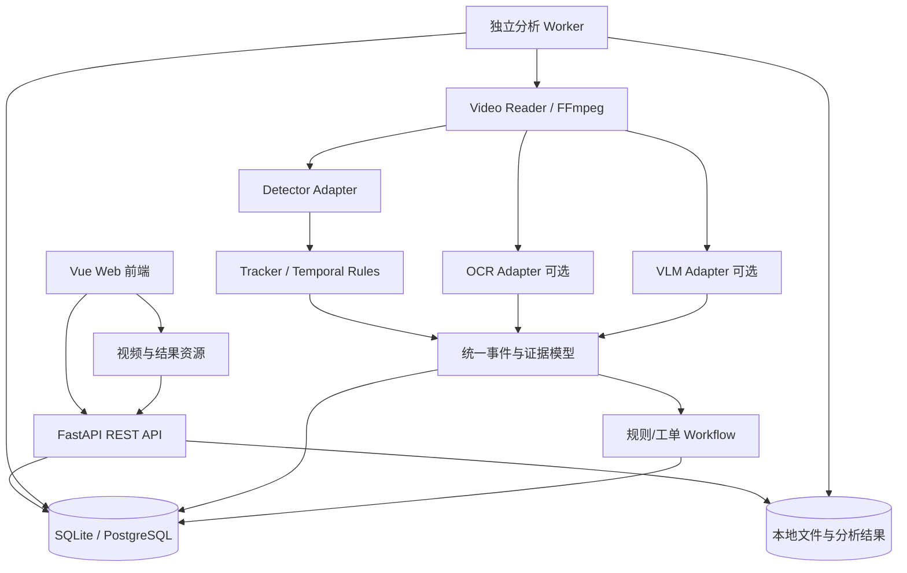

# VisionFlow：智能视频分析与业务自动化平台

> **开发规划 / 学习路线 / Codex 执行说明**  
> 版本：v1.0（2026-10-27）  
> 项目类型：个人学习 + 可展示的工程作品集  
> 目标读者：开发者本人、Codex 代码代理、未来的技术面试官  
> 项目状态：**仅完成规划，尚未开始编码**

---

## 0. 先读这里（给 Codex）

VisionFlow 是一个以**固定机位作业视频**为首个实验场景的开源作品集项目。它要逐步覆盖目标检测、目标跟踪、作业步骤判断、OCR、视觉语言模型（VLM）、模型微调、推理优化和自动化业务流程。

**项目的首要目标是学习与可验证的工程实践，而不是以最快速度堆功能。**

### Codex 必须遵循的工作原则

1. **只执行用户明确批准的当前阶段与任务**，禁止提前实现后续模块。
2. 每项任务先输出：目标、拟修改文件、关键方案、测试方式、预计学习点；再开始修改。
3. 优先使用可理解、可调试的简单方案：单仓库、模块化单体、独立 Worker；不要未经批准引入 Kubernetes、微服务或复杂消息队列。
4. 所有模型必须放在适配层之后；不允许让业务模块直接依赖具体模型 SDK。
5. 写代码时同步补齐测试、README、配置示例、必要的注释；重大技术取舍形成 ADR（架构决策记录）。
6. 对模型训练/微调、评估、推理调优任务，**生成可复现实验脚本和解释**，但不要假装自己已经训练过或捏造指标；训练执行、结果解释应由用户亲自参与。
7. 未提供 GPU、显存和系统环境前，不得假定存在 CUDA/TensorRT。必须提供 CPU 可跑的最小路径。
8. 不要从公司内部项目复制任何代码、视频或数据；必须使用可公开展示或用户已获许可的资料。
9. 不要把模型权重、原始大文件、凭据提交到 Git；遵守数据集、模型、第三方库各自许可证。
10. 一个阶段验收完成后，先输出实际结果与遗留问题，并等待用户明确要求进入下一阶段。

**当前唯一应实现的目标：第 0 阶段与 V0.1 的第一张任务卡。** 后文是路线图，不是一次性开发清单。

---

## 1. 为什么做这个项目

### 1.1 背景与现有能力

开发者已经有 2–3 年 AI 应用软件开发经验，熟悉 Python 后端/API、Vue/React 前端，工作涉及视频分析、现成 CV 模型接入、识别结果处理及业务流程自动化。当前希望在维持全栈能力的同时补齐模型微调、评估、推理部署与优化方面的知识，形成能在面试中直接展示的项目。

### 1.2 预期能力收益

| 求职路线 | 项目中用于证明的能力 |
|---|---|
| AI Application Engineer | 多模型集成、业务流程、Python API、前端展示 |
| Computer Vision Engineer | 数据标注、目标检测微调、评估与错误分析 |
| Video Analytics Engineer | 视频解码、跟踪、状态机、事件判定 |
| AI Inference / Platform Engineer | ONNX Runtime、TensorRT（条件性）、延迟与吞吐量实验 |
| Backend / Full-Stack Engineer | 异步任务、数据库、API、可测试性、部署、可靠性 |
| Enterprise Integration Engineer | 事件驱动的工单、回调、重试、幂等性、审计 |

### 1.3 完成标准

项目最终应当能够：上传一段合法授权的作业视频 → 按任务运行视觉分析 → 查看标注和时间轴 → 人工确认事件 → 触发模拟工单/自动化流程；同时能在仓库中查看**模型训练前后评估**和**推理优化前后基准测试**。

**不追求**从头训练基础模型、大规模多摄像头平台、生产级视频监控系统、复杂账号收费系统。

---

## 2. 业务场景与功能边界

### 2.1 第一场景：固定机位工作台

建议使用自行录制或明确许可的示范视频：人物在固定桌面完成「取料 → 组装/操作 → 检查 → 放置完成品」。检测对象可以从 `person`、`tool`、`component` 中选择，但类别必须由实际视频中可辨认的目标决定，不盲目设定。

核心用户故事：

- 用户上传一个 `.mp4` 视频并创建分析任务。
- 系统输出目标框、类别、置信度和时间戳。
- 随开发阶段增加目标轨迹、作业步骤事件、OCR 文本与 VLM 解释。
- 用户在时间轴中查看/复核事件；确认异常后创建模拟工单。
- 管理端展示任务耗时、模型版本、输出指标和失败原因。

### 2.2 功能边界

**V0.1 必须有：** 视频上传、后台分析、任务状态查询、检测结果、浏览器展示、错误处理、基本测试。

**V0.1 不做：** RTSP 实时流、用户注册、复杂权限、多租户、在线训练、VLM、消息队列集群、GPU 推理服务、Kubernetes、真正的企业 ERP/MES 集成。

**后续再做：** 跟踪、时序事件、OCR/VLM、微调与模型基准、业务工单。

### 2.3 数据与合规

- 仓库只存来源清晰、允许公开的极少量演示样本；禁止公司/客户视频及可识别的私人信息。
- 第三方数据集应单独登记来源、许可、使用范围、是否可再分发；**可下载不等于可商用**。
- 禁止将完整原始视频、敏感数据、模型权重、API 密钥提交仓库；使用 `.gitignore`、`.env.example`。
- 默认本地运行；上传文件实行类型、大小、路径和时长限制；禁止任意 URL 下载和任意路径读写。
- 含人物的视频发布前必须确认采集授权与隐私处理。

---

## 3. 技术选型与条件分支

### 3.1 先用的技术（V0.1）

| 子系统 | 选择 | 原因 |
|---|---|---|
| API | Python + FastAPI + Pydantic | 沿用已有能力、接口定义清晰 |
| 前端 | **Vue 3 + TypeScript + Vite**（优先；也可经用户批准换 React） | 利用已有前端经验，快速实现展示 |
| 持久化 | SQLite（V0.1）→ PostgreSQL（后期条件性） | 避免早期基础设施复杂化 |
| 视频解码 | OpenCV，必要时通过 FFmpeg/ffprobe 获取视频元数据 | 小步验证本地文件处理 |
| 首个检测器 | YOLO26n/s **仅用于学习和基线** | 有训练与导出工具链；应注意许可证 |
| 模型适配 | `Detector` Protocol / Adapter | 以后替换成 RT-DETRv2、ONNX 实现 |
| 后台执行 | **单独 Worker 进程** + 持久化任务记录 | 视频推理是长耗时计算，不放进 HTTP 请求生命周期 |
| 测试 | pytest + FastAPI TestClient，前端 Vitest | 自动化回归；检测器支持 fake/mock |
| 格式化/检查 | Ruff（Python），ESLint + Prettier（前端） | 降低协作成本 |
| 部署 | 开发期本地执行；后期 Docker Compose | 最少的环境依赖 |

> 版本必须在第 0 阶段根据硬件、Python 版本和官方兼容性表锁定，不使用无约束的 `latest` 作为长期可复现依赖。

### 3.2 后续学习工具（不立即安装）

| 模块 | 主方案 | 可选/对照方案 |
|---|---|---|
| 检测微调 | YOLO26n/s | RT-DETRv2-S（Apache-2.0 仓库） |
| 跟踪 | ByteTrack / BoT-SORT | 规则式 ROI/关键点 |
| 动作识别 | 目标跟踪 + 状态机基线 | VideoMAE / MMAction2（选做） |
| OCR | PaddleOCR PP-OCRv6 | 传统 OpenCV 文字区域处理 |
| VLM | Qwen3-VL-4B-Instruct（资源允许时） | 先调用允许使用的推理服务/小规模离线推理 |
| VLM 微调 | ms-swift LoRA/QLoRA（选做，先测显存） | 不训练，仅 prompt/baseline 对比 |
| 推理 | PyTorch → ONNX Runtime | NVIDIA GPU 时再评估 TensorRT |
| 运维 | 日志、指标、Docker | Redis+队列、Triton（有性能证据再引入） |

**许可证提示：** Ultralytics YOLO26 的官方许可提供 AGPL-3.0 / Enterprise 两种路径。个人学习、开源作品与商业闭源部署的义务不同；尤其不要因该项目可运行就默认可以直接嵌入公司私有系统。优先在许可文档确认项目发布方式；如未来重视宽松许可，可研究 RT-DETRv2 替代方案。第三方模型**权重**与框架**代码**的许可证也应分别复核。

### 3.3 按硬件分支

- **无独立 NVIDIA GPU：** V0.1 用小模型 + 短视频 + CPU；训练在允许使用的 GPU 环境按需运行；部署只验证 ONNX Runtime CPU。
- **8–12GB NVIDIA 显存：** 优先小检测模型微调，逐次验证 batch/分辨率；VLM 以推理实验为主，LoRA 需评估内存/量化/图像 token，不预设能跑通。
- **16–24GB 或更高显存：** 可评估更大图像模型或小参数 VLM 的 LoRA/QLoRA，仍需先测试峰值显存。
- **不同显卡/系统：** 以官方 CUDA / ONNX Runtime / TensorRT 支持矩阵为准；TensorRT 不要求所有人完成。

---

## 4. 总体架构



### 4.1 架构约束

- **API 与推理解耦：** API 负责接收、验证、创建任务、查询状态；Worker 负责耗时视频处理。
- **模型与业务解耦：** `Detector`, `Tracker`, `OcrEngine`, `VisionLanguageModel` 提供稳定接口；不同实现可通过配置切换。
- **结果可追溯：** 每次分析记录模型 ID/版本、视频 ID、配置哈希、创建时间、运行环境摘要。
- **任务持久：** Worker 重启后任务状态可恢复；任务状态必须覆盖 `queued/running/succeeded/failed/cancelled`（取消可后期实现），失败保留错误信息。
- **时间基统一：** 所有检测/事件时间使用以视频起点为零点的 `timestamp_ms` 整数；视频抽帧时保存源时间戳，不以默认 FPS 反推。
- **像素坐标：** 目标框一律明确 `x1,y1,x2,y2` 与原视频帧像素坐标的映射，不允许不同模型输出在业务层混用。
- **可复现：** 训练、评估、性能测试有独立命令和结果目录，不覆盖此前实验。

### 4.2 推荐目录（项目初始，仅建当前需要的文件）

```text
visionflow/
├── AGENTS.md                          # Codex 约束与当前阶段
├── README.md                          # 运行入口与演示
├── docs/
│   ├── VisionFlow_Development_Plan.md # 本文档
│   ├── roadmap.md                    # 实际进度、阻塞、验收记录
│   ├── decisions/                    # ADR 架构决策
│   ├── learning/                     # 分阶段知识笔记、个人问答
│   └── benchmarks/                   # 真实基准测试与误差分析
├── backend/
│   ├── app/
│   │   ├── api/                      # REST 路由
│   │   ├── core/                     # 配置、错误与日志
│   │   ├── domain/                   # 数据模式与业务类型
│   │   ├── storage/                  # 数据库、文件存取
│   │   ├── vision/                   # Detector / 模型 Adapter
│   │   └── workers/                  # 独立进程与任务执行器
│   ├── tests/
│   └── pyproject.toml
├── frontend/
│   └── ...                            # Vue3 + Vite
├── experiments/
│   ├── detection/                     # 训练与误差分析
│   ├── temporal/                      # 行为识别对比
│   ├── ocr_vlm/                       # OCR / VLM 实验
│   └── inference/                     # 模型导出与基准
├── configs/                            # 非敏感配置
├── scripts/                            # 开发、测试、工具脚本
├── examples/                           # 合法授权的微量样例
├── .env.example
└── .gitignore

# 不入库：data/raw, data/processed, models, runs, uploads, outputs, .env
```

注意：`experiments/` 可先只建说明文件，等进入相应阶段再添加模块；不要提前实现空壳系统。

---

## 5. 数据契约与接口设计

### 5.1 最小持久化实体

- `Video`: `id`, `original_filename`, `stored_path`, `duration_ms`, `width`, `height`, `fps`, `created_at`。
- `AnalysisJob`: `id`, `video_id`, `status`, `model_id`, `config_json`, `created_at`, `started_at`, `finished_at`, `error_message`。
- `Detection`: `job_id`, `timestamp_ms`, `frame_index`, `class_id`, `class_name`, `confidence`, `bbox_xyxy`，可先以 JSONL 存储，后期再迁移 DB。
- `Event`（阶段 2 引入）: `id`, `video_id`, `job_id`, `type`, `start_ms`, `end_ms`, `confidence`, `evidence`, `review_status`。
- `WorkOrder`（阶段 5 引入）: `id`, `source_event_id`, `status`, `created_at`, `retry_count`, `external_ref`。

### 5.2 V0.1 API（初步约定）

| 方法 | 路径 | 行为 |
|---|---|---|
| `POST` | `/api/v1/videos` | 上传 MP4；返回 `video_id` 与元数据 |
| `POST` | `/api/v1/jobs` | 根据 `video_id` 创建分析任务；返回 `job_id` |
| `GET` | `/api/v1/jobs/{job_id}` | 返回状态、进度、错误、模型和输出摘要 |
| `GET` | `/api/v1/jobs/{job_id}/detections?offset=0&limit=100` | 分页查询带时间戳的检测结果 |
| `GET` | `/api/v1/videos/{video_id}` | 视频元数据 |
| `GET` | `/api/v1/videos/{video_id}/content` | 限定范围地读取视频内容（支持浏览器所需的 Range） |
| `GET` | `/health` | 进程存活与基本依赖状态 |

上传成功 ≠ 分析完成；异步任务必须返回明确状态，避免前端一直等待 POST 结束。

### 5.3 检测结果 JSON 示例（**仅作为结构示例，不代表真实推理结果**）

```json
{
  "job_id": "job_demo_001",
  "video_id": "video_demo_001",
  "timestamp_ms": 1520,
  "frame_index": 38,
  "model_id": "yolo26n_coco_baseline",
  "class_id": 0,
  "class_name": "person",
  "confidence": 0.91,
  "bbox_xyxy": [100.0, 52.0, 312.0, 460.0]
}
```

### 5.4 Worker 的最低正确性要求

- 单个 Worker + SQLite 原子领取任务，确保同一任务不会同时被两个 Worker 重复执行。
- 重启时区分失联的 `running` 任务并提供人工/自动恢复策略；不做无界自动重试。
- 文件扫描采用受控采样间隔（例如 2 FPS）与有界队列；每次明确源时间戳。
- 分析失败不丢失原始任务记录，便于排查；输出文件使用临时路径 + 完成后原子替换。
- UI 不依赖不断轮询大型结果文件；分页返回有限数据量。

---

## 6. 十六周阶段路线与验收

> 假设每周投入约 6–8 小时；总计 16 周为**规划目标而非承诺时限**。按照实际工作和硬件可调整，优先完成能展示的版本。

| 阶段 | 周次 | 技术路线 | 发布节点 |
|---|---:|---|---|
| 阶段 0：启动 | 第 1 周前段 | 环境评估、许可、架构骨架 | 可运行的空 API + Web |
| 阶段 1：检测与微调 | 1–4 | 视频上传、预训练模型基线、PyTorch 微调、评估 | V0.1（约第2周）、V0.2（约第4周） |
| 阶段 2：视频时序 | 5–7 | 跟踪、ROI、规则状态机、步骤时间轴 | V0.25 |
| 阶段 3：OCR / VLM | 8–10 | PaddleOCR、Qwen3-VL、条件性 LoRA | V0.3 |
| 阶段 4：模型部署 | 11–13 | ONNX、CPU/GPU 推理对比、TensorRT（条件性） | V0.4 |
| 阶段 5：业务闭环 | 14–16 | 工作流、工单、稳定性、演示与文档 | V1.0 |

### 阶段 0：仓库启动与可运行骨架

**目标：** 让用户可以用最少命令启动后端、前端，并理解项目结构。

**技术路线：** Git → Python 环境锁定 → FastAPI → Vue 3 → pytest/Vitest → README。先检测 GPU/操作系统/FFmpeg，不强制安装 CUDA。

**Codex 任务：**

- `P0-01` 建立项目骨架、`.gitignore`、`.env.example`、基础文档及工具检查脚本。
- `P0-02` 实现 `GET /health`、Swagger/OpenAPI、前端显示 API 连接状态。
- `P0-03` 增加一项最简单的前后端自动化测试与开发命令；不创建完整业务模块。

**学习目标（必须能自己回答）：**

- Python 虚拟环境与依赖锁定为什么重要？
- FastAPI 的请求校验、响应模型和 OpenAPI 如何协作？
- 前端如何调用后端 API？跨域问题在哪里处理？
- 为什么模型代码需要单独适配层？

**验收：** 后端健康检查返回成功；前端展示后端状态；测试通过；README 可以在一台干净机器上复现（如果尚未真实验证，只能标“待验证”）。

### 阶段 1：V0.1 检测基线 + V0.2 微调（第 1–4 周）

**技术路线：** 视频上传 → ffprobe / OpenCV → 独立 Worker → 预训练检测器 → 带时间戳检测结果 → 前端时间轴；随后数据标注 → 迁移学习 → 验证集/测试集 → 误差分析。

**任务卡：**

- `P1-01` 上传/视频元数据/文件边界校验；限制 `.mp4`、文件尺寸与视频时长（上限由配置指定）。
- `P1-02` 持久化 `AnalysisJob`、Worker 领取与状态流转；用 fake detector 实现端到端测试。
- `P1-03` 接入预训练 YOLO26n（资源允许可改 s），输出检测 JSONL、图片/抽样可视化；记录模型版本和环境信息。
- `P1-04` 前端视频播放器、任务状态、目标框与可点击时间轴。
- `P1-05` 数据集清单与许可记录，CVAT 标注 200–500 帧作为初始学习规模，划分训练/验证/测试。
- `P1-06` 用户亲自运行一次检测微调，保留配置、种子、模型版本、最佳权重索引、曲线和错误样例。
- `P1-07` 同一**独立测试集**比较微调前后 `Precision / Recall / mAP50 / mAP50-95`，撰写实验结论。

**学习目标：**

1. 检测模型输出：类别、置信度、目标框、NMS/端到端检测头的差异。
2. Precision/Recall、mAP 为什么不能只看一个；什么是业务误报/漏报。
3. 数据划分与泄漏：同一视频的邻近帧不能跨 train/val/test；可以按拍摄视频/日期/机位划分。
4. PyTorch 迁移学习、损失、反向传播、冻结层、数据增强、学习率；区分验证集与最终测试集。
5. 从视频到结构化数据的整个工程流程。

**验收：** V0.1 可以处理短视频并展示真实检测结果；V0.2 产生一份实验报告，记录全部实际结果和失败案例。**不要求微调一定优于基线**；必须解释结果与下一步假设。

**留痕：** `docs/learning/stage1_detection.md`、`docs/benchmarks/detection_baseline.md`、配置和数据清单（不公开受限数据）。

### 阶段 2：目标跟踪与作业步骤识别（第 5–7 周）

**技术路线：** 检测框 → ByteTrack/BoT-SORT → 区域/位移/驻留特征 → 规则状态机 → 时间轴事件；VideoMAE 作为选做对照，不是必做主线。

**任务卡：**

- `P2-01` 集成跟踪器，对 track ID、遮挡、短时丢失进行处理与可视化。
- `P2-02` 为固定机位配置 ROI 区域，并实现一个最小状态机（例：取料 → 操作 → 完成）。
- `P2-03` 输出 `Event(start_ms,end_ms,evidence)`；在 UI 上展示时间轴和证据帧。
- `P2-04` 与“仅检测+简单规则”的基线对比，保存错误类型与误判视频。
- `P2-05`（选做）用 VideoMAE 或轻量片段分类器对同一任务建模，比较收益与成本。

**学习目标：** 检测与跟踪的区别、时间戳处理、状态机与动作识别的适用边界、跟踪 ID 切换与漏检对步骤判定的影响、事件级别的 Precision/Recall/F1。

**验收：** 选定的示例作业视频输出可人工核对的步骤序列；至少收集并解释几类真实误判（例如遮挡、漏检、跨 ROI、过短动作）。

### 阶段 3：OCR 与多模态视觉理解（第 8–10 周）

**技术路线：** PaddleOCR PP-OCRv6 读取工单/标签/屏幕 → 结构化 OCR 结果；Qwen3-VL-4B-Instruct 分析**有限长度**片段或采样帧 → 标准化问答/事件证据；资源充裕、有足够评估数据时才研究 ms-swift LoRA。

**任务卡：**

- `P3-01` 接入 OCR Adapter；保留文字、置信度、位置、采样时间；用 CER（字符错误率）评估。
- `P3-02` 选取 20–50 个固定格式问答样例建立 VLM 基线；严格按视频片段划分评估。
- `P3-03` 将 VLM 用于**难例复核**，不默认逐帧调用；保存 prompt、输入帧采样策略、模型版本和输出。
- `P3-04`（选做）若硬件/数据许可充分，组织训练/验证/测试三部分样例，使用 LoRA/QLoRA 做微调并与未微调模型比较。
- `P3-05` 设计“不确定/需要人工复核”输出，避免将语言模型的文本判断当作自动事实。

**学习目标：** OCR 检测与识别的区分、CER/WER、VLM 视觉 token 与视频采样、提示词基线和 LoRA 的区别、幻觉/无依据回答和事件可信度。

**验收：** 展示 OCR 与 VLM 的有效样例及失败案例。VLM 微调**可延期**；没有基线数据及可复现评估时，不开展 LoRA 训练。

### 阶段 4：推理部署与性能分析（第 11–13 周）

**技术路线：** PyTorch 检测器 → ONNX 导出 → ONNX Runtime CPU（必做）→ CUDA/TensorRT（有硬件时做）；不同后端都必须遵守统一输出协议。

**任务卡：**

- `P4-01` 导出 ONNX，确保模型输入尺寸、归一化、坐标变换、NMS 行为和输出名称可追溯。
- `P4-02` 逐帧比较原模型与 ONNX 的类别、框、置信度差异；设置数值误差容限并记录例外。
- `P4-03` 分别测量解码、预处理、模型推理、后处理、写入、整体端到端耗时。
- `P4-04` 记录 P50/P95 延迟、吞吐量、CPU/GPU 利用率（如可得）、峰值显存、输入尺寸、精度和 batch。
- `P4-05`（条件性）NVIDIA GPU 下测试 TensorRT FP16，再评估 INT8 的标定成本与精度损失。
- `P4-06` 制作可复用的基准脚本，禁止跨硬件、跨输入比较后声称“性能提升 X 倍”。

**学习目标：** ONNX 计算图、Execution Provider、FP32/FP16/INT8、模型输出数值一致性、吞吐量与延迟权衡、预处理和解码瓶颈、GPU 使用率与真实性能差异。

**验收：** 真实基准表注明硬件/系统/环境/模型版本/样本量/测试方法；优化前后功能保持可接受的一致性。不能运行 TensorRT 时，说明限制并仅完成 CPU/ONNX 对比。

### 阶段 5：业务闭环 + 面试作品集（第 14–16 周）

**技术路线：** 事件 → 人工审核 → 工作流规则 → 模拟工单 → 幂等/重试/审计；前端演示 + 部署脚本 + 稳定性测试。

**任务卡：**

- `P5-01` 加入事件审核状态、评论与可追踪的证据帧。
- `P5-02` 将已确认事件转成工单（可由用户点击确认后触发），使用模拟 ERP/MES HTTP 服务，不连接真实生产系统。
- `P5-03` 实现幂等键、失败重试、最大重试次数、审计日志、取消/重跑策略。
- `P5-04` Docker Compose 部署（API + Worker + Web + DB）；必要时升级 PostgreSQL。
- `P5-05` 测试错误视频、模型异常、Worker 崩溃、重复事件、磁盘空间不足等场景。
- `P5-06` 整理 README、架构图、演示视频、实际基准、实验报告和 3 份不同求职方向的项目描述。

**学习目标：** 事件驱动的系统设计、消息/任务幂等、可观测性、故障恢复、容器化、端到端测试、对外展示技术决策。

**验收：** 全流程能够在新环境按文档运行；模拟工单成功且重复触发不会制造重复记录；存在可展示的成功/失败用例；关键指标可追溯。

---

## 7. 课程式学习机制（必须做，不得只交代码）

每个阶段都必须创建对应 `docs/learning/stageN_*.md`，包含以下五部分：

1. **概念解释**：本阶段新技术的定义、使用场景、与其他选型的关系。
2. **关键设计**：本项目为什么选它？替代方案是什么？
3. **亲自实验**：用户可以独立执行的一条命令或最小实验。
4. **思考问题**：至少 3 个需要开发者自己回答的问题；Codex 不直接替代其解释。
5. **实验复盘**：记录用户真实观察、失败、修复、结果及下一步方向。

学习过程建议坚持：**先理解 → 自己操作 → 观察指标 → 解释为什么 → 再委托 Codex 完善工程代码**。

示例（阶段 1）：

- 什么情况会导致验证集 mAP 很高，但新视频误报很多？
- 为什么固定机位视频不应按帧随机划分训练集与测试集？
- 学习率过大时训练曲线可能出现什么变化？
- 何时选择减小模型，而不是继续增加训练轮数？

**严禁在文档中填入虚构实验数据。** 没测过写 `Not measured`，不确定写 `Unverified`。

---

## 8. 指标与实验记录模板

每项实验都应使用独立的 ID：`DET-YYYYMMDD-01`、`INF-YYYYMMDD-01` 等，并保存：

```yaml
experiment_id: DET-YYYYMMDD-01
purpose: "验证微调是否改善特定作业目标检测"
dataset_name: "需填写"
dataset_license: "需填写"
split_policy: "按视频/日期划分"
train_count: null
val_count: null
test_count: null
model_name: "需填写"
weights_revision: "需填写"
framework_version: "需填写"
seed: 42
hyperparameters: {}
hardware: "需填写"
metrics:
  precision: null
  recall: null
  map50: null
  map50_95: null
notes: "未运行前不可填真实数值"
```

| 任务 | 主要指标 | 注意 |
|---|---|---|
| 检测 | P/R、mAP50、mAP50-95 | 需说明 IoU 阈值与样本划分 |
| 跟踪/步骤 | IDF1（如使用）、步骤 F1、时间边界误差 | 用人工核对的事件标注做真值 |
| OCR | CER；可选字段提取正确率 | 区分文字识别错误与字段匹配错误 |
| VLM | 固定测试题准确率、无依据回答率、拒答质量 | 不使用主观几条案例取代测试集 |
| 推理 | P50/P95 延迟、吞吐量、端到端耗时、显存 | 同一硬件、数据、预处理下比较 |
| 自动化 | 重复工单数、任务失败率、恢复结果 | 需要构造失败与重试测试 |

面试讲述结构推荐：**业务问题 → 基线方案 → 遇到的限制 → 做出的技术取舍 → 真实结果 → 没解决的问题**。

---

## 9. Git、测试和交付规范

### 分支及提交

- `main`：稳定可演示；`feat/p1-video-upload` 等小功能分支。
- 提交信息建议：`feat(api): add video upload validation`、`test(worker): cover retry flow`、`docs(stage1): add detection benchmark`。
- 每个 PR/阶段提交包含目的、变更、测试命令、截图/日志（无敏感数据）、风险与遗留问题。

### 最低测试要求

- API：上传失败场景、未知 job、任务状态、JSON 序列化。
- Worker：使用 fake detector 的完整处理流程、重启/错误状态、重复领取保护。
- 数据：坐标范围、时间戳单调、模型输出空结果处理。
- 前端：上传交互、状态展示、失败提示；可先做组件级测试。
- 模型：固定少量样本的 smoke test；正式效果测试单独放在 evaluation，不把精度数据做成脆弱单元测试。

### 定义完成（Definition of Done）

任务完成必须同时满足：

- [ ] 对应功能可运行或提供明确不可运行的硬件/环境限制说明
- [ ] 有自动化测试或可复现的人工测试步骤
- [ ] README/当前阶段文档与实现一致
- [ ] 无凭据或禁止公开的数据入库
- [ ] Codex 说明了架构选择、文件变更、潜在风险与学习问题
- [ ] 开发者亲自验收核心行为并同意结束任务

---

## 10. 已知风险及降级策略

| 风险 | 降级方案 |
|---|---|
| 无合适 NVIDIA GPU | CPU + 小检测模型 + 短视频；训练资源另行评估 |
| 数据集授权不足 | 自行录制匿名示范视频、合成场景；不可对外公开未授权视频 |
| 标注量太小、效果不稳定 | 先证明流程可复现与误差分析，不声称达到生产级准确率 |
| 动作复杂、规则频繁误判 | 限定可观察步骤和固定摄像头条件；高阶时序模型列为选做 |
| VLM LoRA 成本过高 | 保持 VLM 零样本/少样本基线，延后微调 |
| TensorRT 兼容性问题 | 以 ONNX Runtime CPU / CUDA 为基线，记录问题 |
| Web 系统工作量挤占学习 | 前端只做上传、视频和时间轴，不追求复杂 UI |
| 误把结果当事实 | 关键事件人工复核、输出证据与置信度 |
| 开源发布与模型许可冲突 | 逐一核实权重和代码许可；必要时换模型或改变发布方式 |

---

## 11. 作品集最终展示结构

仓库首页 README 最终包括：

- 一张架构图和一段简洁介绍。
- 一分钟 GIF/短视频展示（必须是合法公开数据）。
- 一条最简单的本地启动路径，说明最低硬件要求。
- 关键模块：检测/跟踪/OCR/VLM/工作流，分别标注哪些已实现、哪些是可选实验。
- 模型微调前后对比：指标与失败案例。
- 推理性能报告：设备与完整测试条件。
- 设计取舍、已知局限、未来改进。
- 数据来源与许可证表。

**针对不同岗位的演示重点：**

- CV：第 1、2、3 阶段实验结果与错误分析。
- 推理平台：第 4 阶段模型一致性、延迟和部署参数。
- 后端/全栈：第 0、1、5 阶段架构、任务状态、幂等/重试/测试。

---

## 12. 官方资料与许可证检查入口（2026-10-27 核查）

> 具体 API、包版本会更新。Codex 编写命令前应再次查官方文档，并在仓库锁定实际测试过的版本。

- [Ultralytics YOLO26 官方模型文档](https://docs.ultralytics.com/models/yolo26)
- [Ultralytics 官方许可证说明](https://www.ultralytics.com/license)
- [RT-DETR / RT-DETRv2 官方仓库（Apache-2.0）](https://github.com/lyuwenyu/RT-DETR)
- [PyTorch Transfer Learning Tutorial](https://docs.pytorch.org/tutorials/beginner/transfer_learning_tutorial.html)
- [PaddleOCR 官方仓库（Apache-2.0）](https://github.com/PaddlePaddle/PaddleOCR)
- [Qwen3-VL-4B-Instruct 模型卡（Apache-2.0）](https://huggingface.co/Qwen/Qwen3-VL-4B-Instruct)
- [ms-swift 多模态微调](https://github.com/modelscope/ms-swift)
- [ONNX Runtime Execution Providers](https://onnxruntime.ai/docs/execution-providers/)
- [NVIDIA TensorRT 文档](https://docs.nvidia.com/deeplearning/tensorrt/latest/)
- [FastAPI Background Tasks 指南](https://fastapi.tiangolo.com/tutorial/background-tasks/)（对于重任务建议独立 Worker）
- [CVAT 标注工具](https://github.com/cvat-ai/cvat)
- [MMAction2 动作识别框架](https://github.com/open-mmlab/mmaction2)

---

## 13. Codex 的第一个实际执行任务

**不要一次性生成整个项目。请从 `P0-01` 开始。**

### P0-01：项目初始化

**目标：** 建立能继续开发的代码仓库骨架，尚不实现视频分析功能。

**输入：** 本文档、`AGENTS.md`，以及用户后续提供的操作系统、Python 版本、GPU 信息。

**步骤：**

1. 读取本文与 `AGENTS.md`，简述理解；列出下一步将创建/修改的文件。
2. 探测现有目录内容，不删除用户文件。
3. 建立 `backend` 与 `frontend` 最小骨架，加入 README、忽略规则、环境配置示例。
4. 提供 `backend`/`frontend` 各自的启动命令，并确认这些命令真正可执行。
5. 增加 `GET /health`，在浏览器前端展示连接状态；增加最少一项后端测试。
6. 生成 `docs/roadmap.md` 和 `docs/learning/stage0_foundations.md`，记录测试结果与下一步 `P0-02`。
7. 汇报完成与未完成事项，**停止并等待用户验收**。

### 可直接发给 Codex 的第一条指令

> 请先阅读仓库中的 `AGENTS.md` 和 `docs/VisionFlow_Development_Plan.md`。当前仅执行阶段 0 的 `P0-01`。先确认已有仓库结构与本机开发环境，再提交简短实施计划。禁止提前实现视频分析、数据库复杂表、OCR/VLM 或推理优化。完成后列出改动文件、测试结果、运行命令和需要我亲自理解的 3 个技术问题，等待我验收后再继续。

---

## 14. 进度记录规则

在 `docs/roadmap.md` 持续维护：

| Task ID | 标题 | 状态 | 证据/提交 | 遗留问题 | 用户验收 |
|---|---|---|---|---|---|
| P0-01 | 项目初始化 | TODO | — | 需确认本机环境 | 未验收 |
| P0-02 | API + Web 最小闭环 | TODO | — | — | 未验收 |
| P1-01 | 视频上传与校验 | TODO | — | — | 未验收 |

状态允许 `TODO / IN_PROGRESS / BLOCKED / DONE`，`DONE` 必须有可查证据。任何阶段完成后都应更新此表。

**核心原则：项目不是技术清单，而是能解释、能测量、能运行、能展示的持续学习成果。**
